## Positivity-Tours-Travels-Website-Case-Study
# Positivity Tours & Travels Website Case Study

Client website case study for Positivity Tours & Travels, a Siliguri-based travel agency website with tour packages, destination pages, hotel bookings, car rentals, an admin panel, responsive design, and live deployment.

## Overview

This is a client website case study for Positivity Tours & Travels, a tour and travel business based in Siliguri, West Bengal (established 2020). The website was built to create a modern online presence, showcase tour packages across Darjeeling, Sikkim, Pelling, Bhutan, and Leh Ladakh, present hotel and car rental services, and help travellers enquire and book through a clear call/WhatsApp/contact flow.

The site also includes a custom admin panel, so the client can update packages, destinations, hotels, cars, blog posts, testimonials, and gallery photos without editing code.

## Live Website

https://positivitytoursntravels.com/

## Project Type

Client Website Development

## Business Category

Travel Agency / Tour Operator / Hotel Booking & Car Rental Services

## Key Features

* Modern travel homepage design
* Hero banner with "Best Tours & Travel Packages" headline
* Limited-time offer popup (20% OFF on every package)
* Tour packages page with duration, location, inclusions, and enquiry buttons
* Top destinations section (Darjeeling, Gangtok, Pelling, Bhutan, Leh Ladakh)
* Hotel bookings page with ratings, amenities, and price per night
* Car rental page with vehicle type, features, and price per day
* "Why Choose Us" section
* About page with company profile and certifications/registrations
* Customer testimonials page
* Photo gallery page
* Travel blog
* Floating WhatsApp and Call buttons on every page
* Contact and enquiry section
* Custom admin panel to manage website content
* Image upload for packages, hotels, cars, and gallery
* SEO page titles and meta descriptions
* Responsive website layout
* Live website deployment

## Tech Stack

* React
* TypeScript
* Vite
* Bootstrap
* SCSS
* Swiper.js
* React Router
* PHP (REST API)
* MySQL
* Responsive Web Design
* Live Server Deployment
* Claude-assisted development

## My Role

I worked on the website structure, page layout, content placement, responsive design, tour package and destination presentation, hotel and car rental sections, the enquiry user flow, the admin panel and PHP/MySQL backend, and deployment support. I used Claude to assist in building and improving the website for a real client project.

## Screenshots

### Homepage

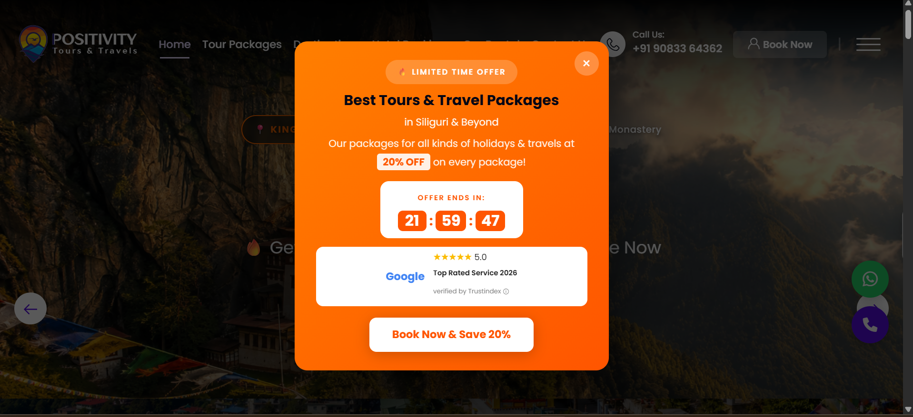
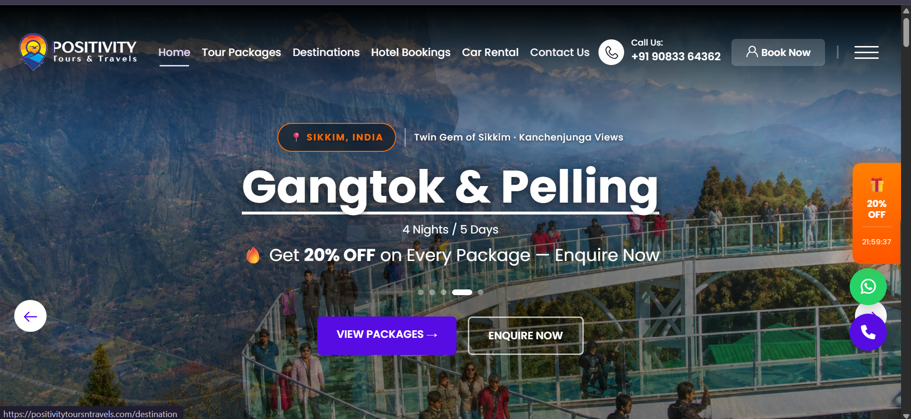
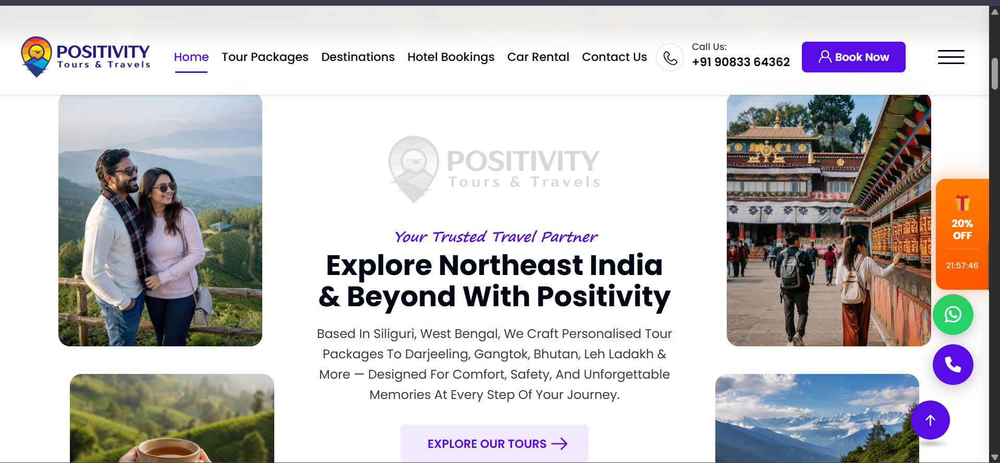
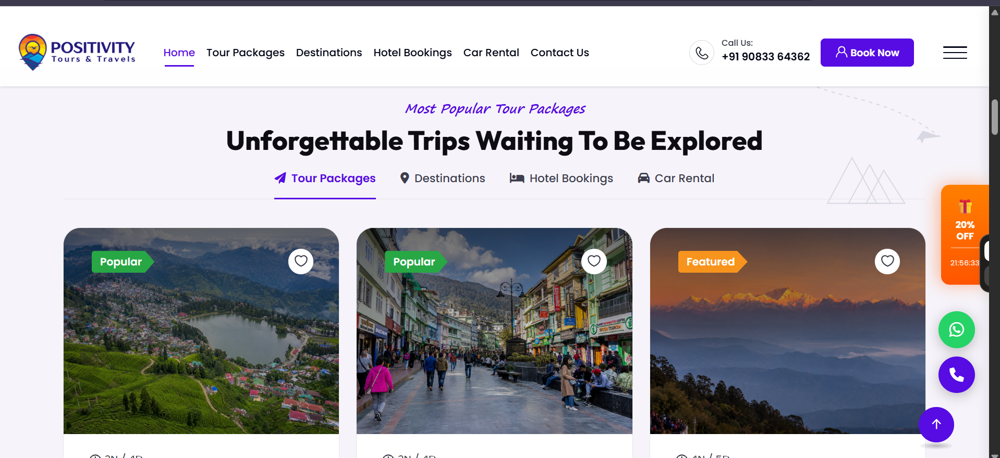

### Tour Packages Section

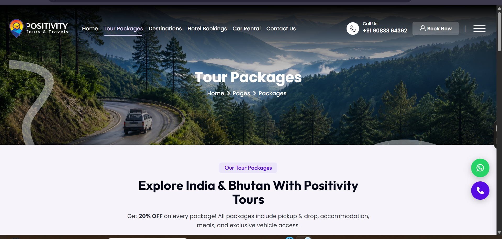
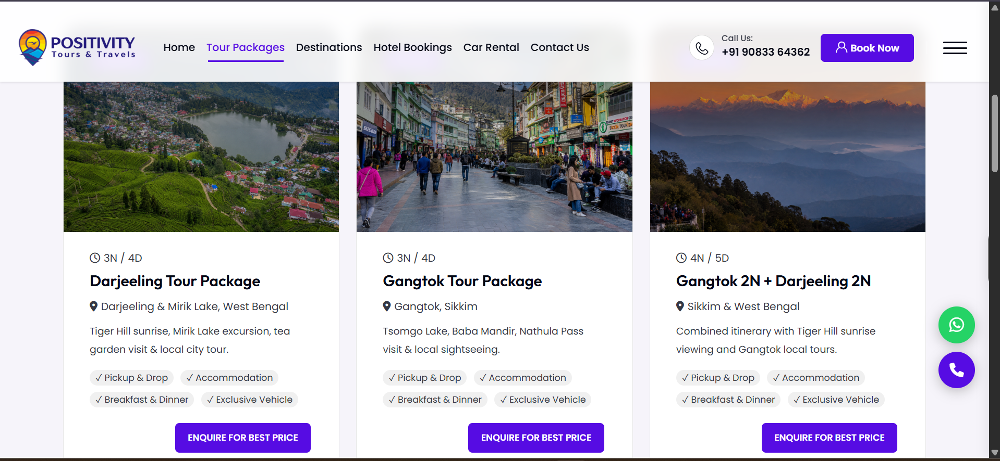

### Destinations Section

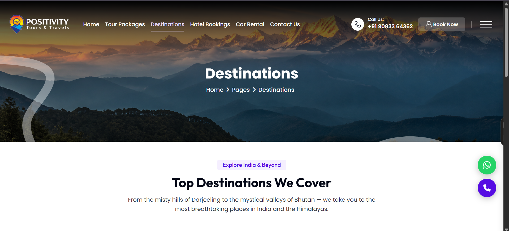
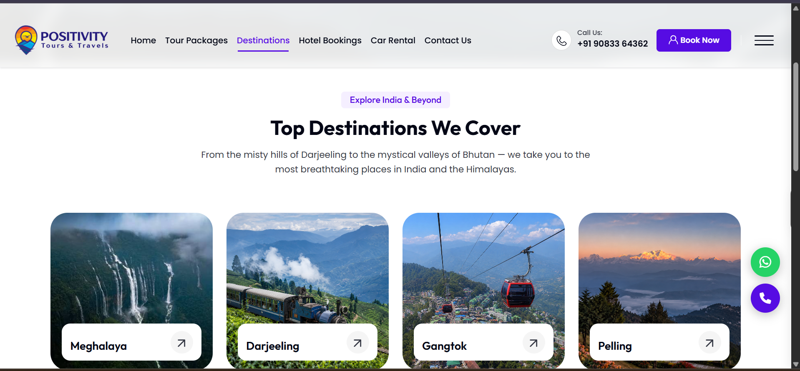

### Hotel Bookings Section

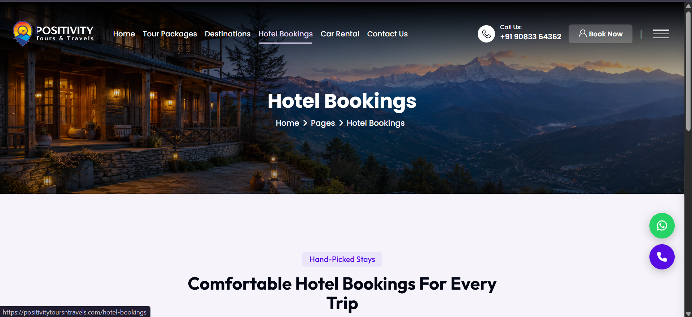

### Car Rental Section

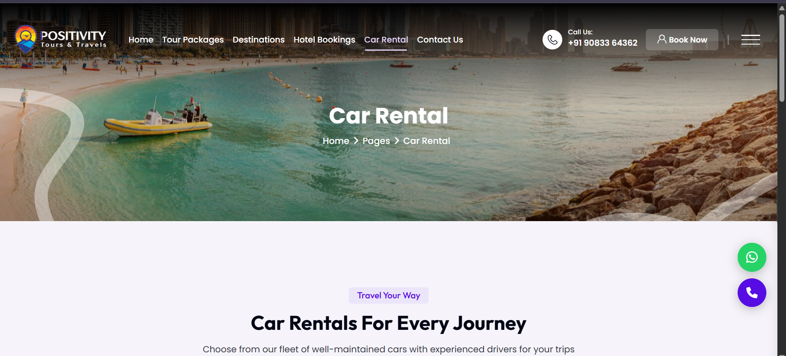
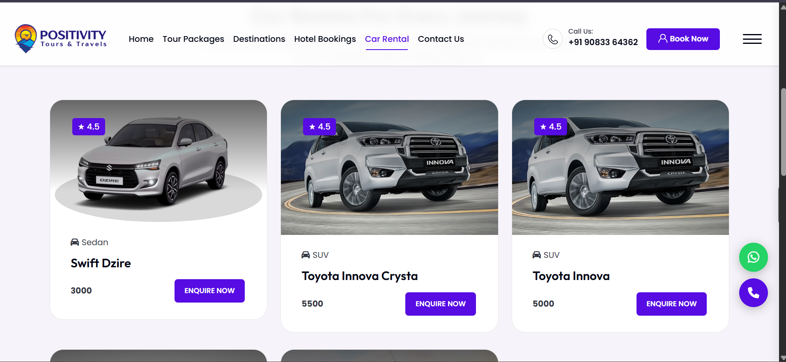

### About Section

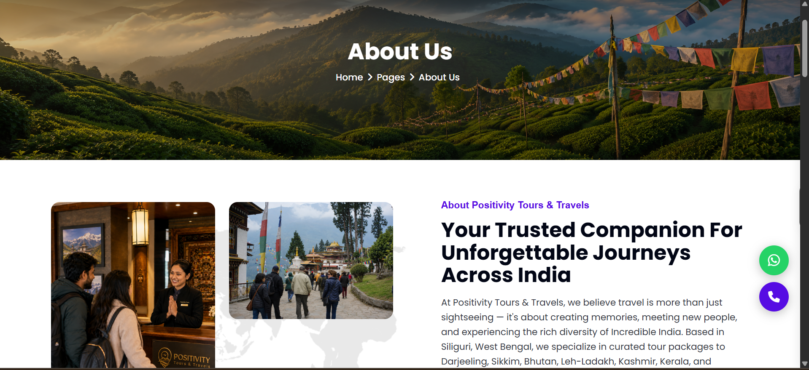

### Testimonials Section

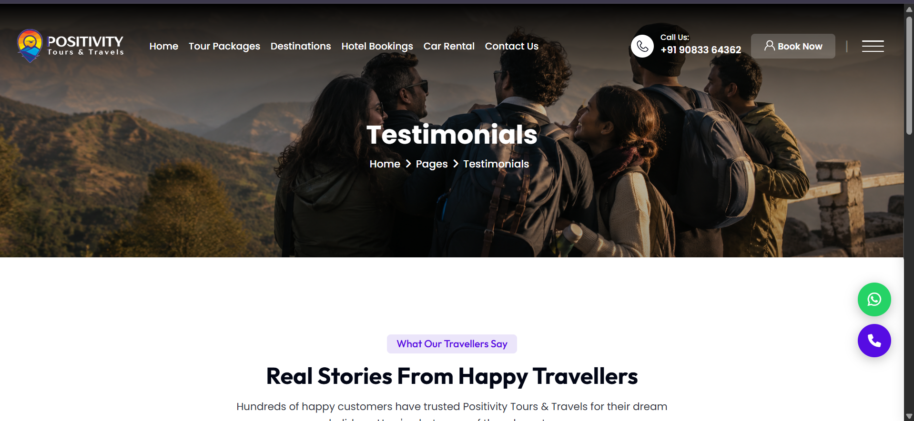
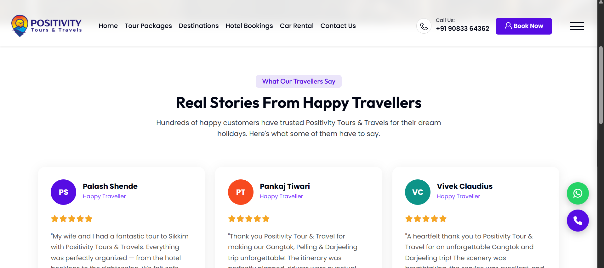

### Gallery Section

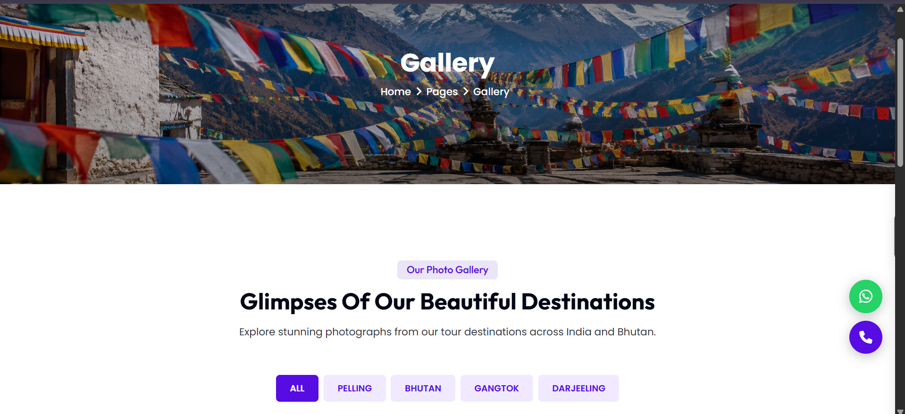
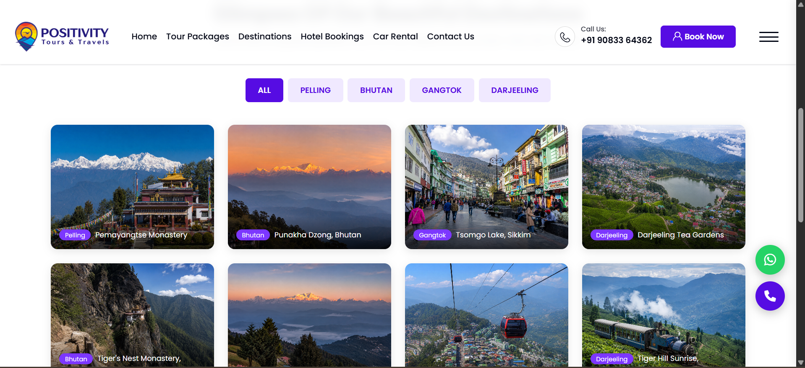

### Contact Section

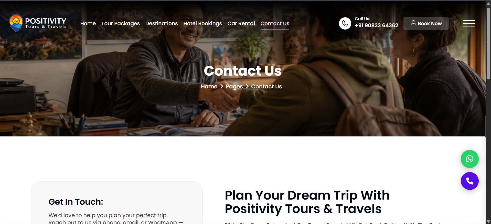

## Status

Completed and live.

## Confidentiality Note

This repository is a portfolio case study. Sensitive client data, admin access, backend files, database credentials, email credentials, form submissions, customer enquiries, hosting credentials, and private source code are not included.
